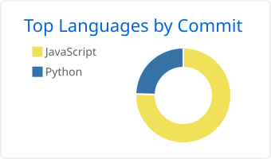

# Hi, I'm Guilherme Rodrigues

<div>

<p align="left">
<a href="https://www.linkedin.com/in/iamgrodrigues" rel="nofollow"></a>&nbsp;&nbsp;
<a href="https://trailblazer.me/id/iamgrodrigues" rel="nofollow"></a>&nbsp;&nbsp;
<a href="https://salesforce.stackexchange.com/users/93793/iamgrodrigues" rel="nofollow"></a>&nbsp;&nbsp;
<a href="https://stackoverflow.com/users/14347023/iamgrodrigues" rel="nofollow"></a>&nbsp;&nbsp;
<a href="https://www.instagram.com/iamgrodrigues" rel="nofollow"></a>
</p>

<p><strong>Salesforce Developer at WEX | São Paulo, Brazil</strong></p>
<p>I enjoy partnering with business teams to understand the need behind a request, then shaping it into practical Salesforce solutions.</p>
<p>Good delivery starts with asking the right questions. Clear requirements, thoughtful design, and maintainable code guide my work, without making simple things complicated.</p>
<p>AI is part of that approach, from Agentforce solutions that help business teams work smarter to a pair-programming partner in my development workflow. Exploring alternatives, challenging assumptions, and reviewing solutions with AI helps me deliver better work, while I stay responsible for the decisions and results.</p>
<p>Always curious, I keep learning through Trailhead and the Salesforce community, exploring ideas and sharing what I discover along the way.</p>
</div>
<br clear="left" />

<picture>
  <source media="(prefers-color-scheme: dark)" srcset="https://raw.githubusercontent.com/iamgrodrigues/iamgrodrigues/output/github-contribution-grid-snake-dark.svg">
  <source media="(prefers-color-scheme: light)" srcset="https://raw.githubusercontent.com/iamgrodrigues/iamgrodrigues/output/github-contribution-grid-snake.svg">
  
</picture>

<details> 
 <summary>🤖 <b>My programming stats</b></summary>
<br>
  
<!--START_SECTION:waka-->


**🐱 My GitHub Data** 

> 📦 3.3 kB Used in GitHub's Storage 
 > 
> 🏆 480 Contributions in the Year 2026
 > 
> 💼 Opted to Hire
 > 
> 📜 2 Public Repositories 
 > 
> 🔑 3 Private Repositories 
 > 
**I'm a Night 🦉** 

```text
🌞 Morning                227 commits         ███████░░░░░░░░░░░░░░░░░░   27.35 % 
🌆 Daytime                166 commits         █████░░░░░░░░░░░░░░░░░░░░   20.00 % 
🌃 Evening                205 commits         ██████░░░░░░░░░░░░░░░░░░░   24.70 % 
🌙 Night                  232 commits         ███████░░░░░░░░░░░░░░░░░░   27.95 % 
```
📅 **I'm Most Productive on Monday** 

```text
Monday                   141 commits         ████░░░░░░░░░░░░░░░░░░░░░   16.99 % 
Tuesday                  81 commits          ██░░░░░░░░░░░░░░░░░░░░░░░   09.76 % 
Wednesday                109 commits         ███░░░░░░░░░░░░░░░░░░░░░░   13.13 % 
Thursday                 129 commits         ████░░░░░░░░░░░░░░░░░░░░░   15.54 % 
Friday                   107 commits         ███░░░░░░░░░░░░░░░░░░░░░░   12.89 % 
Saturday                 126 commits         ████░░░░░░░░░░░░░░░░░░░░░   15.18 % 
Sunday                   137 commits         ████░░░░░░░░░░░░░░░░░░░░░   16.51 % 
```


📊 **This Week I Spent My Time On** 

```text
🕑︎ Time Zone: America/Sao_Paulo

💬 Programming Languages: 
Markdown                 22 hrs 18 mins      ███████████░░░░░░░░░░░░░░   42.51 % 
Bash                     9 hrs 26 mins       ████░░░░░░░░░░░░░░░░░░░░░   18.00 % 
Apex                     9 hrs               ████░░░░░░░░░░░░░░░░░░░░░   17.17 % 
XML                      6 hrs 2 mins        ███░░░░░░░░░░░░░░░░░░░░░░   11.51 % 
JSON                     2 hrs 9 mins        █░░░░░░░░░░░░░░░░░░░░░░░░   04.11 % 

🔥 Editors: 
Copilot CLI              23 hrs 8 mins       ███████████░░░░░░░░░░░░░░   44.11 % 
Copilot                  20 hrs 38 mins      ██████████░░░░░░░░░░░░░░░   39.33 % 
VS Code                  8 hrs 21 mins       ████░░░░░░░░░░░░░░░░░░░░░   15.95 % 
Zsh                      19 mins             ░░░░░░░░░░░░░░░░░░░░░░░░░   00.61 % 

🐱‍💻 Projects: 
ai-toolkit               22 hrs 22 mins      ███████████░░░░░░░░░░░░░░   42.64 % 
to-sf-sfdcmaster         13 hrs 19 mins      ██████░░░░░░░░░░░░░░░░░░░   25.39 % 
sf-cps                   9 hrs 20 mins       ████░░░░░░░░░░░░░░░░░░░░░   17.80 % 
salesforce-lab           3 hrs 17 mins       ██░░░░░░░░░░░░░░░░░░░░░░░   06.26 % 
work-reflections         2 hrs 21 mins       █░░░░░░░░░░░░░░░░░░░░░░░░   04.50 % 

💻 Operating System: 
WSL                      52 hrs 27 mins      █████████████████████████   100.00 % 
```

🤖 **AI Coding This Week** 

```text
⏱ AI Coding Time: 50 hrs 31 mins (96.31%)

✍️ 2,249 lines written by AI, 3,869 lines written by hand (36.76% AI-written)

🔤 91,262,721 Input Tokens, 8,470,866 Output Tokens

💵 $3512.38 Estimated AI Cost This Week

🧠 109 AI Sessions, 1109 AI Prompts

GPT                      3,098 lines         ████████████████████████░   95.71 % 
Code                     139 lines           █░░░░░░░░░░░░░░░░░░░░░░░░   04.29 % 
Opus                     0 lines             ░░░░░░░░░░░░░░░░░░░░░░░░░   00.00 % 
Sonnet                   0 lines             ░░░░░░░░░░░░░░░░░░░░░░░░░   00.00 % 

🔎 AI Coding Insights:
⚖️ Balanced with AI — 36.76% of written lines came from AI
📄 Detailed Prompter — average 515 characters per prompt
🔁 Iterative Prompter — average 10 prompts per session
🔍 Hands-On Reviewer — 70.98% of changed lines were hand-edited
```

**I Mostly Code in Python** 

```text
Python                   2 repos             █████████████████░░░░░░░░   66.67 % 
JavaScript               1 repo              ████████░░░░░░░░░░░░░░░░░   33.33 % 
```


 Last Updated on 27/11/2026 06:18:05 UTC
<!--END_SECTION:waka-->

</details>
<details>	
   <summary><b>⚡ GitHub Stats</b></summary>
<div>
<picture>
	<source media="(prefers-color-scheme: dark)" srcset="https://raw.githubusercontent.com/iamgrodrigues/iamgrodrigues/profile-stats/gotham/3-stats.svg" />
	<source media="(prefers-color-scheme: light)" srcset="https://raw.githubusercontent.com/iamgrodrigues/iamgrodrigues/profile-stats/github/3-stats.svg" />
	
</picture>
<picture>
	<source media="(prefers-color-scheme: dark)" srcset="https://raw.githubusercontent.com/iamgrodrigues/iamgrodrigues/profile-stats/gotham/2-most-commit-language.svg" />
	<source media="(prefers-color-scheme: light)" srcset="https://raw.githubusercontent.com/iamgrodrigues/iamgrodrigues/profile-stats/github/2-most-commit-language.svg" />
	
</picture>
</div>
<!-- Cards are refreshed by .github/workflows/profile_stats.yml. GH_TOKEN must belong to
the profile owner and have read access to the private repositories to include.
Enable "Include private contributions on my profile" in GitHub's contribution settings.
The first successful workflow run publishes the light and dark images to profile-stats,
then wraps only these two cards in theme-aware picture elements: GitHub for light mode
and Gotham for dark mode. Until then, the existing Gotham images stay in use.
Stars and "Contributed to" remain public-only. -->
</details>
