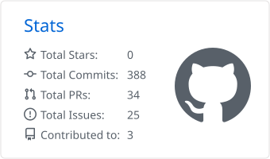

# Hi, I'm Guilherme Rodrigues

<div>

<p align="left">
<a href="https://www.linkedin.com/in/iamgrodrigues" rel="nofollow"></a>&nbsp;&nbsp;
<a href="https://trailblazer.me/id/iamgrodrigues" rel="nofollow"></a>&nbsp;&nbsp;
<a href="https://salesforce.stackexchange.com/users/93793/iamgrodrigues" rel="nofollow"></a>&nbsp;&nbsp;
<a href="https://stackoverflow.com/users/14347023/iamgrodrigues" rel="nofollow"></a>&nbsp;&nbsp;
<a href="https://www.instagram.com/iamgrodrigues" rel="nofollow"></a>
</p>

<p><strong>Salesforce Developer at WEX | São Paulo, Brazil</strong></p>
<p>I enjoy partnering with business teams to understand the need behind a request, then shaping it into practical Salesforce solutions.</p>
<p>Good delivery starts with asking the right questions. Clear requirements, thoughtful design, and maintainable code guide my work, without making simple things complicated.</p>
<p>AI is part of that approach, from Agentforce solutions that help business teams work smarter to a pair-programming partner in my development workflow. Exploring alternatives, challenging assumptions, and reviewing solutions with AI helps me deliver better work, while I stay responsible for the decisions and results.</p>
<p>Always curious, I keep learning through Trailhead and the Salesforce community, exploring ideas and sharing what I discover along the way.</p>
</div>
<br clear="left" />

<picture>
  <source media="(prefers-color-scheme: dark)" srcset="https://raw.githubusercontent.com/iamgrodrigues/iamgrodrigues/output/github-contribution-grid-snake-dark.svg">
  <source media="(prefers-color-scheme: light)" srcset="https://raw.githubusercontent.com/iamgrodrigues/iamgrodrigues/output/github-contribution-grid-snake.svg">
  
</picture>

<details> 
 <summary>🤖 <b>My programming stats</b></summary>
<br>
  
<!--START_SECTION:waka-->


**🐱 My GitHub Data** 

> 📦 3.0 kB Used in GitHub's Storage 
 > 
> 🏆 234 Contributions in the Year 2026
 > 
> 💼 Opted to Hire
 > 
> 📜 2 Public Repositories 
 > 
> 🔑 3 Private Repositories 
 > 
**I'm an Early 🐤** 

<svg width="720" viewBox="0 0 720 116" xmlns="http://www.w3.org/2000/svg"><text x="0" y="16" font-family="monospace" font-size="13" fill="#99D1CE">🌞 Morning</text><text x="170" y="16" font-family="monospace" font-size="13" fill="#599CAB">205 commits</text><rect x="280" y="6" width="360" height="8" rx="0" fill="#0C1014"/><rect x="280" y="6" width="178" height="8" rx="0" fill="#2AA889"/><text x="648" y="16" font-family="monospace" font-size="12" fill="#599CAB">49.52%</text><text x="0" y="40" font-family="monospace" font-size="13" fill="#99D1CE">🌆 Daytime</text><text x="170" y="40" font-family="monospace" font-size="13" fill="#599CAB">97 commits</text><rect x="280" y="30" width="360" height="8" rx="0" fill="#0C1014"/><rect x="280" y="30" width="84" height="8" rx="0" fill="#2AA889"/><text x="648" y="40" font-family="monospace" font-size="12" fill="#599CAB">23.43%</text><text x="0" y="64" font-family="monospace" font-size="13" fill="#99D1CE">🌃 Evening</text><text x="170" y="64" font-family="monospace" font-size="13" fill="#599CAB">64 commits</text><rect x="280" y="54" width="360" height="8" rx="0" fill="#0C1014"/><rect x="280" y="54" width="56" height="8" rx="0" fill="#2AA889"/><text x="648" y="64" font-family="monospace" font-size="12" fill="#599CAB">15.46%</text><text x="0" y="88" font-family="monospace" font-size="13" fill="#99D1CE">🌙 Night</text><text x="170" y="88" font-family="monospace" font-size="13" fill="#599CAB">48 commits</text><rect x="280" y="78" width="360" height="8" rx="0" fill="#0C1014"/><rect x="280" y="78" width="42" height="8" rx="0" fill="#2AA889"/><text x="648" y="88" font-family="monospace" font-size="12" fill="#599CAB">11.59%</text></svg>
📅 **I'm Most Productive on Friday** 

<svg width="720" viewBox="0 0 720 188" xmlns="http://www.w3.org/2000/svg"><text x="0" y="16" font-family="monospace" font-size="13" fill="#99D1CE">Monday</text><text x="170" y="16" font-family="monospace" font-size="13" fill="#599CAB">100 commits</text><rect x="280" y="6" width="360" height="8" rx="0" fill="#0C1014"/><rect x="280" y="6" width="87" height="8" rx="0" fill="#2AA889"/><text x="648" y="16" font-family="monospace" font-size="12" fill="#599CAB">24.15%</text><text x="0" y="40" font-family="monospace" font-size="13" fill="#99D1CE">Tuesday</text><text x="170" y="40" font-family="monospace" font-size="13" fill="#599CAB">70 commits</text><rect x="280" y="30" width="360" height="8" rx="0" fill="#0C1014"/><rect x="280" y="30" width="61" height="8" rx="0" fill="#2AA889"/><text x="648" y="40" font-family="monospace" font-size="12" fill="#599CAB">16.91%</text><text x="0" y="64" font-family="monospace" font-size="13" fill="#99D1CE">Wednesday</text><text x="170" y="64" font-family="monospace" font-size="13" fill="#599CAB">55 commits</text><rect x="280" y="54" width="360" height="8" rx="0" fill="#0C1014"/><rect x="280" y="54" width="48" height="8" rx="0" fill="#2AA889"/><text x="648" y="64" font-family="monospace" font-size="12" fill="#599CAB">13.29%</text><text x="0" y="88" font-family="monospace" font-size="13" fill="#99D1CE">Thursday</text><text x="170" y="88" font-family="monospace" font-size="13" fill="#599CAB">64 commits</text><rect x="280" y="78" width="360" height="8" rx="0" fill="#0C1014"/><rect x="280" y="78" width="56" height="8" rx="0" fill="#2AA889"/><text x="648" y="88" font-family="monospace" font-size="12" fill="#599CAB">15.46%</text><text x="0" y="112" font-family="monospace" font-size="13" fill="#99D1CE">Friday</text><text x="170" y="112" font-family="monospace" font-size="13" fill="#599CAB">107 commits</text><rect x="280" y="102" width="360" height="8" rx="0" fill="#0C1014"/><rect x="280" y="102" width="93" height="8" rx="0" fill="#2AA889"/><text x="648" y="112" font-family="monospace" font-size="12" fill="#599CAB">25.85%</text><text x="0" y="136" font-family="monospace" font-size="13" fill="#99D1CE">Saturday</text><text x="170" y="136" font-family="monospace" font-size="13" fill="#599CAB">0 commits</text><rect x="280" y="126" width="360" height="8" rx="0" fill="#0C1014"/><rect x="280" y="126" width="0" height="8" rx="0" fill="#2AA889"/><text x="648" y="136" font-family="monospace" font-size="12" fill="#599CAB">0.00%</text><text x="0" y="160" font-family="monospace" font-size="13" fill="#99D1CE">Sunday</text><text x="170" y="160" font-family="monospace" font-size="13" fill="#599CAB">18 commits</text><rect x="280" y="150" width="360" height="8" rx="0" fill="#0C1014"/><rect x="280" y="150" width="16" height="8" rx="0" fill="#2AA889"/><text x="648" y="160" font-family="monospace" font-size="12" fill="#599CAB">4.35%</text></svg>


📊 **This Week I Spent My Time On** 

🕑︎ Time Zone: America/Sao_Paulo

💬 Programming Languages: 
<svg width="720" viewBox="0 0 720 140" xmlns="http://www.w3.org/2000/svg"><text x="0" y="16" font-family="monospace" font-size="13" fill="#99D1CE">Apex</text><text x="170" y="16" font-family="monospace" font-size="13" fill="#599CAB">14 hrs 7 mins</text><rect x="280" y="6" width="360" height="8" rx="0" fill="#0C1014"/><rect x="280" y="6" width="103" height="8" rx="0" fill="#2AA889"/><text x="648" y="16" font-family="monospace" font-size="12" fill="#599CAB">28.55%</text><text x="0" y="40" font-family="monospace" font-size="13" fill="#99D1CE">Markdown</text><text x="170" y="40" font-family="monospace" font-size="13" fill="#599CAB">14 hrs 3 mins</text><rect x="280" y="30" width="360" height="8" rx="0" fill="#0C1014"/><rect x="280" y="30" width="102" height="8" rx="0" fill="#2AA889"/><text x="648" y="40" font-family="monospace" font-size="12" fill="#599CAB">28.41%</text><text x="0" y="64" font-family="monospace" font-size="13" fill="#99D1CE">Python</text><text x="170" y="64" font-family="monospace" font-size="13" fill="#599CAB">5 hrs 56 mins</text><rect x="280" y="54" width="360" height="8" rx="0" fill="#0C1014"/><rect x="280" y="54" width="43" height="8" rx="0" fill="#2AA889"/><text x="648" y="64" font-family="monospace" font-size="12" fill="#599CAB">12.01%</text><text x="0" y="88" font-family="monospace" font-size="13" fill="#99D1CE">Bash</text><text x="170" y="88" font-family="monospace" font-size="13" fill="#599CAB">4 hrs 56 mins</text><rect x="280" y="78" width="360" height="8" rx="0" fill="#0C1014"/><rect x="280" y="78" width="36" height="8" rx="0" fill="#2AA889"/><text x="648" y="88" font-family="monospace" font-size="12" fill="#599CAB">9.99%</text><text x="0" y="112" font-family="monospace" font-size="13" fill="#99D1CE">XML</text><text x="170" y="112" font-family="monospace" font-size="13" fill="#599CAB">3 hrs 43 mins</text><rect x="280" y="102" width="360" height="8" rx="0" fill="#0C1014"/><rect x="280" y="102" width="27" height="8" rx="0" fill="#2AA889"/><text x="648" y="112" font-family="monospace" font-size="12" fill="#599CAB">7.53%</text></svg>

🔥 Editors: 
<svg width="720" viewBox="0 0 720 116" xmlns="http://www.w3.org/2000/svg"><text x="0" y="16" font-family="monospace" font-size="13" fill="#99D1CE">Copilot CLI</text><text x="170" y="16" font-family="monospace" font-size="13" fill="#599CAB">27 hrs 40 mins</text><rect x="280" y="6" width="360" height="8" rx="0" fill="#0C1014"/><rect x="280" y="6" width="201" height="8" rx="0" fill="#2AA889"/><text x="648" y="16" font-family="monospace" font-size="12" fill="#599CAB">55.91%</text><text x="0" y="40" font-family="monospace" font-size="13" fill="#99D1CE">Copilot</text><text x="170" y="40" font-family="monospace" font-size="13" fill="#599CAB">11 hrs 38 mins</text><rect x="280" y="30" width="360" height="8" rx="0" fill="#0C1014"/><rect x="280" y="30" width="85" height="8" rx="0" fill="#2AA889"/><text x="648" y="40" font-family="monospace" font-size="12" fill="#599CAB">23.54%</text><text x="0" y="64" font-family="monospace" font-size="13" fill="#99D1CE">VS Code</text><text x="170" y="64" font-family="monospace" font-size="13" fill="#599CAB">8 hrs 15 mins</text><rect x="280" y="54" width="360" height="8" rx="0" fill="#0C1014"/><rect x="280" y="54" width="60" height="8" rx="0" fill="#2AA889"/><text x="648" y="64" font-family="monospace" font-size="12" fill="#599CAB">16.70%</text><text x="0" y="88" font-family="monospace" font-size="13" fill="#99D1CE">Zsh</text><text x="170" y="88" font-family="monospace" font-size="13" fill="#599CAB">1 hr 54 mins</text><rect x="280" y="78" width="360" height="8" rx="0" fill="#0C1014"/><rect x="280" y="78" width="14" height="8" rx="0" fill="#2AA889"/><text x="648" y="88" font-family="monospace" font-size="12" fill="#599CAB">3.85%</text></svg>

🐱‍💻 Projects: 
<svg width="720" viewBox="0 0 720 140" xmlns="http://www.w3.org/2000/svg"><text x="0" y="16" font-family="monospace" font-size="13" fill="#99D1CE">to-sf-sfdcmaster</text><text x="170" y="16" font-family="monospace" font-size="13" fill="#599CAB">36 hrs 33 mins</text><rect x="280" y="6" width="360" height="8" rx="0" fill="#0C1014"/><rect x="280" y="6" width="266" height="8" rx="0" fill="#2AA889"/><text x="648" y="16" font-family="monospace" font-size="12" fill="#599CAB">73.89%</text><text x="0" y="40" font-family="monospace" font-size="13" fill="#99D1CE">salesforce-lab</text><text x="170" y="40" font-family="monospace" font-size="13" fill="#599CAB">3 hrs 11 mins</text><rect x="280" y="30" width="360" height="8" rx="0" fill="#0C1014"/><rect x="280" y="30" width="23" height="8" rx="0" fill="#2AA889"/><text x="648" y="40" font-family="monospace" font-size="12" fill="#599CAB">6.45%</text><text x="0" y="64" font-family="monospace" font-size="13" fill="#99D1CE">iamgrodrigues</text><text x="170" y="64" font-family="monospace" font-size="13" fill="#599CAB">2 hrs 59 mins</text><rect x="280" y="54" width="360" height="8" rx="0" fill="#0C1014"/><rect x="280" y="54" width="22" height="8" rx="0" fill="#2AA889"/><text x="648" y="64" font-family="monospace" font-size="12" fill="#599CAB">6.06%</text><text x="0" y="88" font-family="monospace" font-size="13" fill="#99D1CE">github-activity-mirror</text><text x="170" y="88" font-family="monospace" font-size="13" fill="#599CAB">2 hrs 33 mins</text><rect x="280" y="78" width="360" height="8" rx="0" fill="#0C1014"/><rect x="280" y="78" width="19" height="8" rx="0" fill="#2AA889"/><text x="648" y="88" font-family="monospace" font-size="12" fill="#599CAB">5.18%</text><text x="0" y="112" font-family="monospace" font-size="13" fill="#99D1CE">sf-cps</text><text x="170" y="112" font-family="monospace" font-size="13" fill="#599CAB">2 hrs 22 mins</text><rect x="280" y="102" width="360" height="8" rx="0" fill="#0C1014"/><rect x="280" y="102" width="17" height="8" rx="0" fill="#2AA889"/><text x="648" y="112" font-family="monospace" font-size="12" fill="#599CAB">4.78%</text></svg>

💻 Operating System: 
<svg width="720" viewBox="0 0 720 44" xmlns="http://www.w3.org/2000/svg"><text x="0" y="16" font-family="monospace" font-size="13" fill="#99D1CE">WSL</text><text x="170" y="16" font-family="monospace" font-size="13" fill="#599CAB">49 hrs 29 mins</text><rect x="280" y="6" width="360" height="8" rx="0" fill="#0C1014"/><rect x="280" y="6" width="360" height="8" rx="0" fill="#2AA889"/><text x="648" y="16" font-family="monospace" font-size="12" fill="#599CAB">100.00%</text></svg>


🤖 **AI Coding This Week** 

```text
⏱ AI Coding Time: 46 hrs 32 mins (94.06%)

✍️ 8,615 lines written by AI, 15 lines written by hand (99.83% AI-written)

🔤 37,159,653 Input Tokens, 3,159,477 Output Tokens

💵 $373.46 Estimated AI Cost This Week

🧠 44 AI Sessions, 724 AI Prompts

<svg width="720" viewBox="0 0 720 44" xmlns="http://www.w3.org/2000/svg"><text x="0" y="16" font-family="monospace" font-size="13" fill="#99D1CE">GPT</text><text x="170" y="16" font-family="monospace" font-size="13" fill="#599CAB">10,304 lines</text><rect x="280" y="6" width="360" height="8" rx="0" fill="#0C1014"/><rect x="280" y="6" width="360" height="8" rx="0" fill="#2AA889"/><text x="648" y="16" font-family="monospace" font-size="12" fill="#599CAB">100.00%</text></svg>

🔎 AI Coding Insights:
🤖 AI-Driven — 99.83% of written lines came from AI
📝 Concise Prompter — average 306 characters per prompt
🔁 Iterative Prompter — average 16 prompts per session
🚀 High AI Trust — 0.75% of changed lines were hand-edited
```

**I Mostly Code in Python** 

<svg width="720" viewBox="0 0 720 68" xmlns="http://www.w3.org/2000/svg"><text x="0" y="16" font-family="monospace" font-size="13" fill="#99D1CE">Python</text><text x="170" y="16" font-family="monospace" font-size="13" fill="#599CAB">1 repo</text><rect x="280" y="6" width="360" height="8" rx="0" fill="#0C1014"/><rect x="280" y="6" width="180" height="8" rx="0" fill="#2AA889"/><text x="648" y="16" font-family="monospace" font-size="12" fill="#599CAB">50.00%</text><text x="0" y="40" font-family="monospace" font-size="13" fill="#99D1CE">JavaScript</text><text x="170" y="40" font-family="monospace" font-size="13" fill="#599CAB">1 repo</text><rect x="280" y="30" width="360" height="8" rx="0" fill="#0C1014"/><rect x="280" y="30" width="180" height="8" rx="0" fill="#2AA889"/><text x="648" y="40" font-family="monospace" font-size="12" fill="#599CAB">50.00%</text></svg>


 Last Updated on 17/11/2026 23:29:28 UTC
<!--END_SECTION:waka-->

</details>
<details>	
   <summary><b>⚡ GitHub Stats</b></summary>
<div>
<picture>
	<source media="(prefers-color-scheme: dark)" srcset="https://raw.githubusercontent.com/iamgrodrigues/iamgrodrigues/profile-stats/gotham/3-stats.svg" />
	<source media="(prefers-color-scheme: light)" srcset="https://raw.githubusercontent.com/iamgrodrigues/iamgrodrigues/profile-stats/github/3-stats.svg" />
	
</picture>
<picture>
	<source media="(prefers-color-scheme: dark)" srcset="https://raw.githubusercontent.com/iamgrodrigues/iamgrodrigues/profile-stats/gotham/2-most-commit-language.svg" />
	<source media="(prefers-color-scheme: light)" srcset="https://raw.githubusercontent.com/iamgrodrigues/iamgrodrigues/profile-stats/github/2-most-commit-language.svg" />
	
</picture>
</div>
<!-- Cards are refreshed by .github/workflows/profile_stats.yml. GH_TOKEN must belong to
the profile owner and have read access to the private repositories to include.
Enable "Include private contributions on my profile" in GitHub's contribution settings.
The first successful workflow run publishes the light and dark images to profile-stats,
then wraps only these two cards in theme-aware picture elements: GitHub for light mode
and Gotham for dark mode. Until then, the existing Gotham images stay in use.
Stars and "Contributed to" remain public-only. -->
</details>
